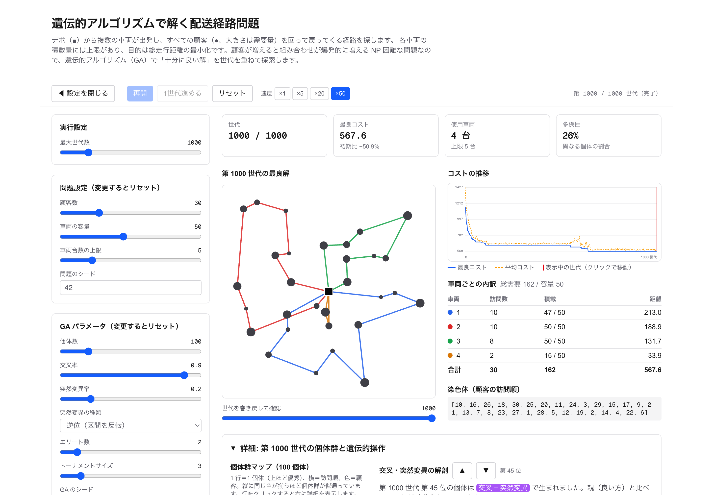
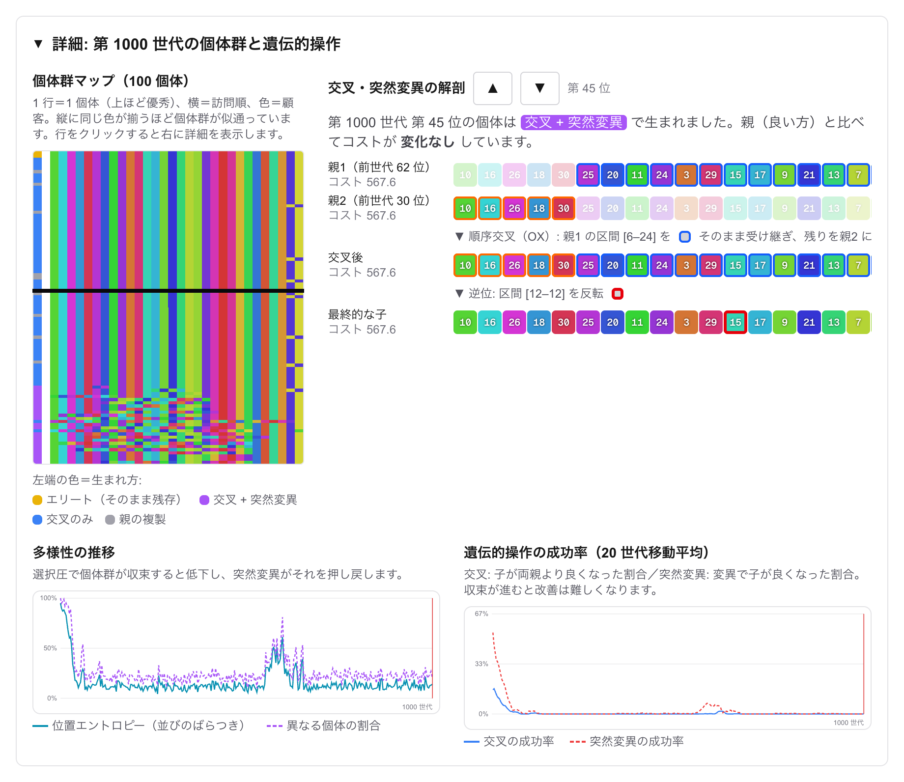

# ga-vrp-playground

遺伝的アルゴリズム（GA）で **配送経路問題（VRP: Vehicle Routing Problem）** を解く様子を、ブラウザ上で可視化しながら学べるデモです。



## 解いている問題

デポ（■）から複数台の車両が出発し、すべての顧客（●、大きさは需要量）を回ってデポへ戻る経路を探します。

- 各車両には積載量の上限がある（容量制約付き VRP）
- 目的は総走行距離の最小化
- NP 困難な問題のため、GA で世代を重ねながら「十分に良い解」を探索する

## 主な機能

- **最良解の経路表示**：世代を巻き戻して、各世代の最良解を確認できる
- **コストの推移**：最良コストと平均コストを世代ごとにグラフ表示
- **染色体の可視化**：顧客の訪問順を色付きの遺伝子列として表示
- **個体群マップ**：1 行 = 1 個体、色 = 顧客。収束していく様子が見える
- **交叉・突然変異の解剖**：選んだ個体が、どの親からどの操作で生まれたかを遺伝子単位で図解
- **多様性・操作成功率の推移**：位置エントロピー、異なる個体の割合、交叉 / 突然変異の成功率
- **パラメータ調整**：顧客数・車両容量・台数・個体数・交叉率・突然変異率・エリート数・トーナメントサイズ・シードなど
- **シード固定**：同じシードなら同じ結果を再現できる



## アルゴリズムの概要

| ステップ | 手法 |
|---|---|
| 遺伝子の表現 | 顧客の訪問順の順列。先頭から積み込み、容量を超える直前で次の車両に切り替える（貪欲分割） |
| 評価 | 総走行距離 + 車両台数の上限を超えた 1 台あたり 100 のペナルティ |
| 選択 | トーナメント選択 |
| 交叉 | 順序交叉（OX） |
| 突然変異 | 逆位（2-opt 相当）または交換 |
| 世代交代 | エリート保存。上位個体はそのまま次世代へ残す |

## 動作環境

- Node.js 20.9 以上
- Next.js 16 / React 19 / TypeScript / Tailwind CSS 4

## セットアップ

```bash
git clone https://github.com/<your-account>/ga-vrp-playground.git
cd ga-vrp-playground
npm install
npm run dev
```

ブラウザで <http://localhost:3000> を開きます。

| コマンド | 内容 |
|---|---|
| `npm run dev` | 開発サーバを起動 |
| `npm run build` | 本番ビルド |
| `npm run start` | ビルド済みアプリを起動 |
| `npm run lint` | ESLint を実行 |

## ディレクトリ構成

```
lib/ga/            GA 本体（UI 非依存）
  vrp.ts           問題生成・染色体のデコード・評価
  ga.ts            選択・交叉・突然変異・世代交代
  simulation.ts    世代履歴の保持
  rng.ts           シード付き乱数
app/
  page.tsx         ページと解説
  components/      可視化コンポーネント（経路・グラフ・個体群マップなど）
```

## ライセンス

[MIT](LICENSE)
